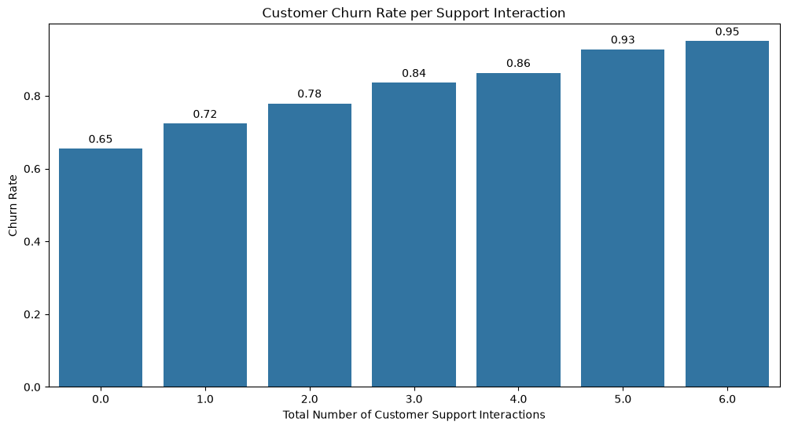
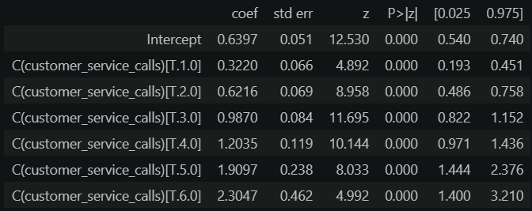
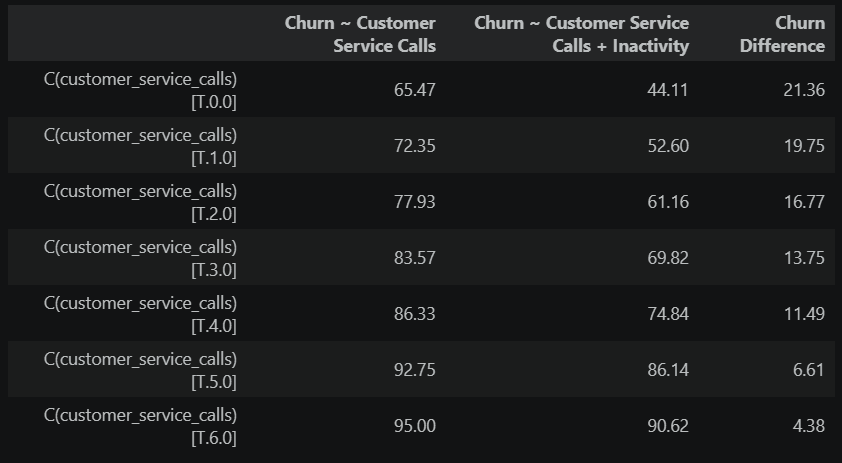
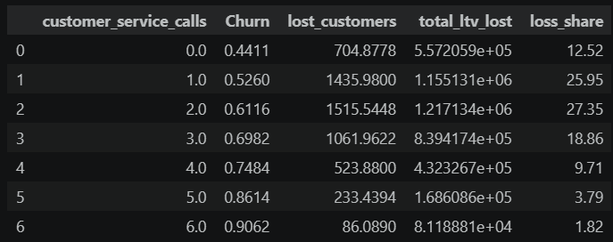

# Customer Churn Analysis: Evaluating the Impact of Support Interactions Using Controlled Logistic Regression

## Overview
    Prior analysis identified customer inactivity as a primary driver of churn. To expand on these findings, this study examines customer service call volume to determine how support interaction frequency influences churn risk. Using both isolated and controlled logistic regression models—with customer inactivity held constant—this analysis tests whether support interactions provide additional explanatory power for churn beyond inactivity alone.

## Question
* Do customer service calls signal frustration or engagement?
* At how many calls should a customer be escalated to retention outreach?
* Do calls matter on their own or just overlap with inactivity?

## Results
| | |
---|---
**_Initial Findings_** Customer Service Calls shows a moderately high `Predicted Risk` with a base churn rate of `65.47%`.  **_Hypothesis Testing on Isolated Variable_** The initial finding is highly supported by the performed isolated logistic regression results, suggesting that support interactions heavily influence customer churn.  **_Hypothesis Decision_** Reject the null hypothesis and conclude that customer service calls or support interactions has a positive effect on the log-odds of customer churnr|
**_Post Findings_** Customer service calls in a controlled logistic regression displays a decrease in churn rate by 4 to 21 points, indicating that part of churn rate in the isolated model is explained by inactivity.  **_Evaluating Customer Support Interaction Threshold Application_** Customers with 3 or less calls account for `84.7%` of the projected annual lost revenue, and the remaining `15.3%` are customer with 4-6 calls. A trigger at 4+ calls would cover 15.3% of projected loss while reaching 11.3% of customers (1,066) A trigger at 3+ calls would cover 34.2% while reaching 27.5% (2,587).|