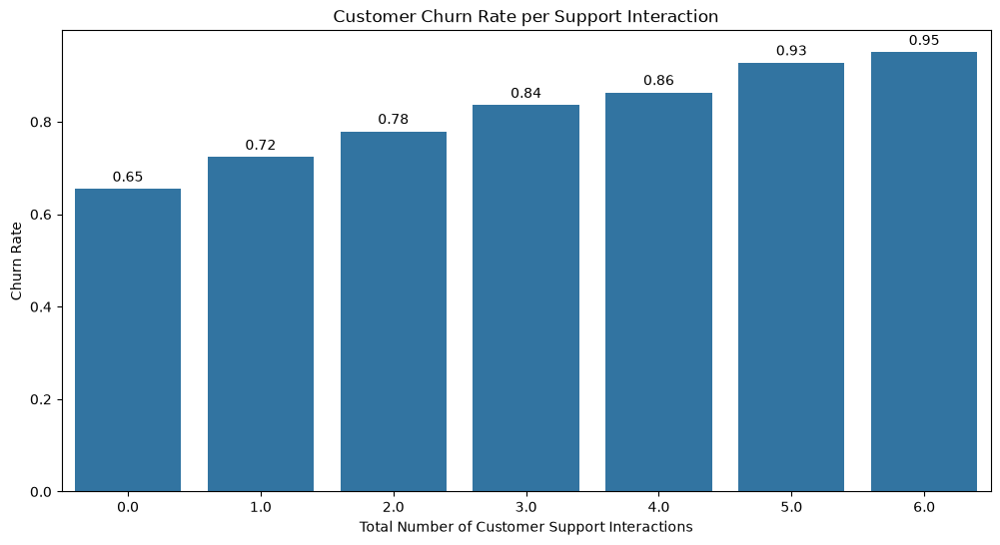
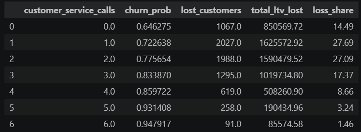

# Executive Summary: Customer Service Calls and Churn

## Question
Are customer service calls associated with churn independently of inactivity, and where would a retention trigger on call count be most useful?

## Key Findings
| | |
---|---
|- Churn rises with every additional call, from 64.6% at 0 calls to 94.8% at 6 or more.  - The association is statistically significant (p < 0.05) and remains after accounting for inactivity, so calls matter beyond inactivity. Part of the effect does overlap: with inactivity held at its lowest level, churn is 4 to 21 points lower at each call count than in the calls-only model.  - Customers with 0–3 calls account for 86.6% of estimated annual revenue lost, mainly because they are 88.7% of customers.|

## Answers to the Questions
- **Frustration or engagement?** Higher call counts go with higher churn, which is consistent with dissatisfaction. The data cannot show why customers called.
- **Independent of inactivity?** Yes, calls remain significant after accounting for inactivity.
- **Escalation point?** No call count is a clear cutoff, because churn rises steadily.

## Recommendation
| Trigger | Customers reached | Share of lost revenue covered |
|---|---|---|
| 4+ calls | 11.3% (1,066) | 13.4% |
| 3+ calls | 27.5% (2,587) | 30.7% |

Both triggers are only slightly better than contacting customers at random (coverage is about 1.1–1.2 times reach).

## Limitations
- The data is a single snapshot, so it shows association, not cause.
- Customers may call because they are about to cancel.
- Churn is high in every group, so results may not generalize.
- Revenue figures assume median monthly spend per group, annualized.

## Details
See the [full analysis notebook](calls_inactivity_churn_analysis.ipynb).