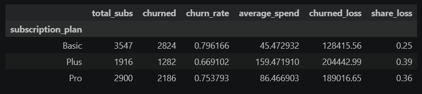

# Executive Summary: Subscription Plans and Revenue Lost to Churn

## Question
    Which subscription plan loses the most revenue to churn, and what share of the total does each plan account for?

## Key Findings
| | |
---|---
|**Plus loses the most revenue** - (39%, about _$204K_ per month), followed by Pro (36%, about _$189K_) and Basic (25%, about _$128K_).  **The ranking differs by metric.** - Basic has the highest churn rate (80%), but its customers pay the least (about _$45_ a month), while Plus has the lowest churn rate but the highest spend (about _$150_).  **Retained customers spend more than churned customers** in every plan.  **Zero-spend customers** are mostly on Basic. [79–86]% of them have churned, and they are excluded from the revenue figures.|
## Recommendation
    Prioritize retention for Plus: each churned Plus customer costs about [3.3] times as much as a Basic customer, and Plus accounts for the largest loss share with the fewest subscribers. Whether retention is worth it depends on the cost of retaining a customer, which this data doesn't include.

## Limitations
- The data is a single snapshot, so it shows association, not cause.
- Revenue lost = average monthly spend × churned customers per plan. It is a monthly estimate and assumes churned customers paid the plan average.
- Zero-spend customers are excluded. If their spend was zeroed after churn, losses are understated.
- Churn is high across all plans, so results may not generalize.

## Details
See the [full analysis notebook](../notebooks/06_subscription_revenue_leak_analysis.ipynb).