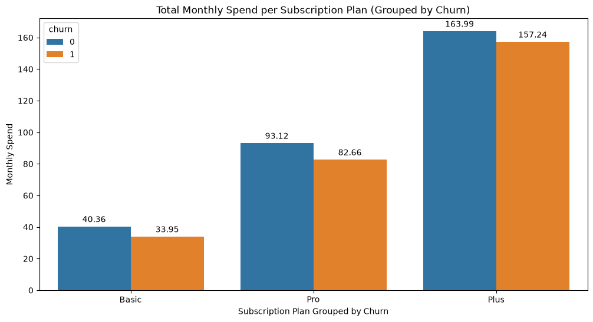
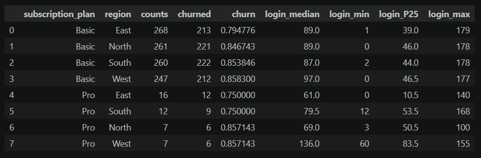
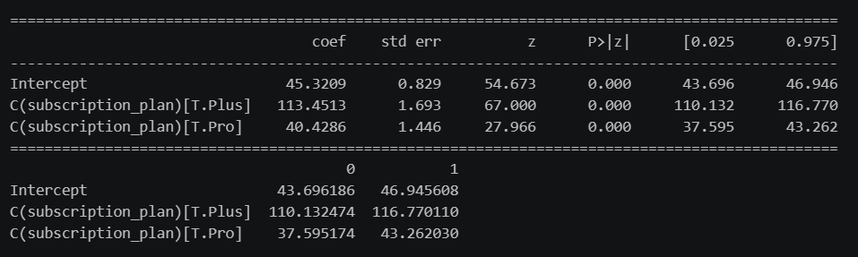

# Subscription Plan Analysis: Identifying Subscription Plan with the Highest Risk and Revenue Loss Share

## Overview
    This project analyze the dataset to determine the attrition per subscription plan and determine the revenue loss and percent loss due to customer churns. The project includes a linear regression model to determine if the revenue vary across all subscription plan.

## Question
* Which subscription plans are the leakiest, and are they worth saving?

## Results
| | |
---|---
**_Initial Findings_** Retained customers spends more than churned customers  **_Hypothesis Testing_** The results shows that there is a significant relationship between `monthly_spend` and `subscription_plan`, which indicates that revenue vary across all tiers.  **_Analysis Results_** _Zero Spenders_ Zero spenders are customer who haven't paid any amount. Majority of zero spenders are in `Basic` plan and are equally distributed across all regions, while few are in the `Pro` plan. Results also shows that almost all of the zero spenders are already churned and 75% are already inactive for more than 30 days across all subscription plan and region.  **_Non Zero Spenders_** Basic plan have the lowest revenue with $45, followed by Pro plan with $40 more than Basic or $85 in total, then Plus plan with the highest average monthly revenue of $110 more than Basic plan or $150 in total.  **_Monthly Total Loss_** Plus is the leakiest plan with a total share loss of 39%, generating a total loss of $204k from churned customers. Pro plan on the other hand have a total share loss of 36% and a total generated loss of $189k from churned customers.|
