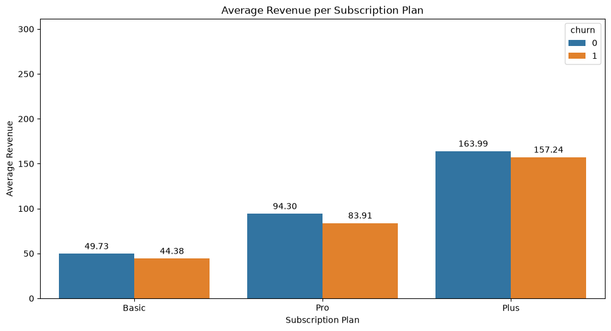
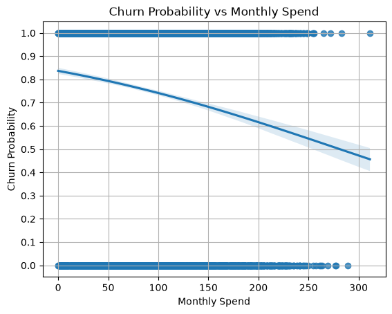
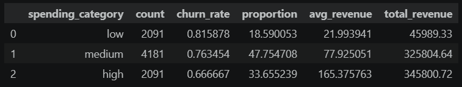

# Customer Loyalty Prediction: Modeling the Relationship Between Spending Patterns and Customer Loyalty
    This project aims to diagnose customer loyalty based on spending behavior and if this holds across all subscription plan.
    
## The Problem
    Previous analysis shows that there is a negative effect between customer churn and revenue. This project will explore the data to determine if spending behavior translates to loyalty or a proxy to subscription plan.

## The Solution
    * The data team will perform a logistic regression model to determine if spending behavior have a significant effect on customer churn and if it is still significant under controlled environment.

## Results
| | |
---|---
**_Initial FIndings_** Retained customers spends an average of `$5`-`$10` higher than churned customers. High total revenue loss due to churn is mainly driven by its large proportion to the total population. Customer churn probability lowers as Monthly Spending increases.  **_Hypothesis Testing_** Monthly Spending remains significant on both isolated and controlled test, indicating that Spending Behavior is the main driver of customer churn.|