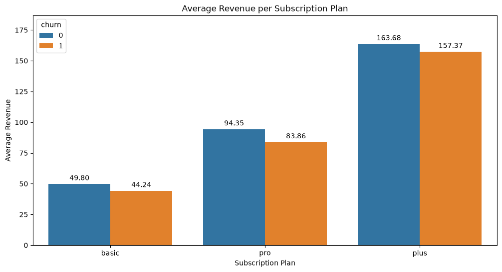
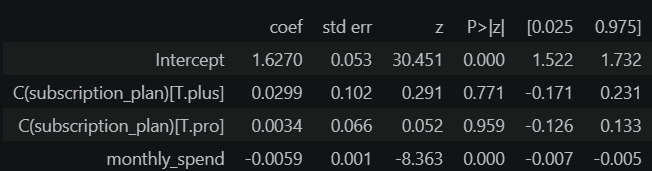
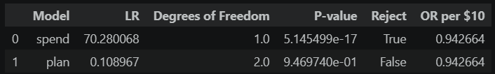

# Executive Summary: Spending and Customer Loyalty

## Question

    Are higher-spending customers more likely to stay, and does this hold after accounting for subscription plan?

    Loyalty means the customer is retained (not churned).

## Key Findings
| | |
---|---
Retained customers spend $5–$10 more per month than churned customers.  Churn falls as spend rises, from about [83]% in the lowest spend group to about [66]% in the highest.  The association holds after accounting for subscription plan (p < 0.05), so spend is not just a proxy for plan. Each extra $10 of monthly spend goes with [5.7]% lower odds of churn.  [Plan also / does not add information once spend is known.]|

## Recommendation
 
    Treat spend as a retention signal, for example to prioritize which customers get outreach. 
    
    Note: Raising customer's spend does not assume lower churn counts.
    

## Limitations
- The data is a single snapshot, so it shows association, not cause.
- Customers who are about to leave may spend less beforehand, so lower spend may be a result of churn.
- Zero-spend customers (mostly churned) are excluded.
- Churn is high in every group, so results may not generalize.

## Details
See the [full analysis notebook](../notebooks/05_customer_loyalty_analysis.ipynb).