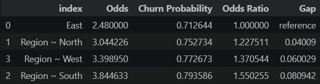

# Profiling the Consumer: Analyzing Behavioral Patterns Across Demographic Cohorts

## The Problem
    Previous analyses indicate that monthly spending, customer inactivity, and customer service interactions are associated with customer churn. To further investigate the factors associated with churn, customer profile characteristics are examined to determine whether demographic and account-related attributes are significantly associated with customers' likelihood of churning.

## The Solution
    The data team will conduct a chi-squared test to determine associations between selected variables and a logistic regression to quantify the Probability and Odds of churn

## Results

| | |
---|---
**_Hypothesis Test_**  **_Chi-Squared ($\chi^2$) Test of Independence_** Only Region has a statistically significant association with customer churn.  **_Churn ~ Age Logistic Regression_** Age shows no association with customer churn  **_Likelihood Ratio using Chi-Squared ($\chi^2$) Test of Independence under Controlled Variables_** Region remains significantly associated with customer churn after controlling for: 1. Monthly Spend 2. Support Interactions (Customer Service Calls) 3. Inactivity (Days Since Last Login)  **_Analysis_** All regions show an unusually high churn rate. Churn Rate Range: [71.3% - 79.4%] North has a +4.0 point higher compared to East (71.3%), with West and South adding roughly 2 points each step.|   