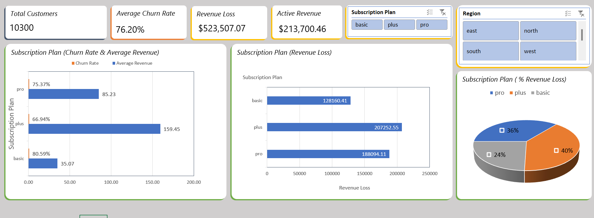

# Customer Churn Dashboard

An interactive Excel dashboard for the E-Commerce Customer Churn Audit. It shows how much monthly revenue is lost to churn, which subscription plans lose the most, and how churn rate and spend differ by plan and region.

## Question
Which subscription plans lose the most revenue to churn, and how do churn rate and average spend differ by plan?

## Key Findings
- **Scale:** 10,300 customers, and 76.2% of them churned.
- **Revenue at stake:** churned customers account for $523,507 of monthly spend, compared with $213,700 from retained customers. That is 71% of all recorded monthly spend.
- **Plus loses the most revenue** ($207,253, 39.6% of the total) even though it has the lowest churn rate (66.9%), because its customers spend the most (about $159 a month on average).
- **Basic churns the most** (80.6%) but accounts for the smallest loss ($128,160, 24.5%), because its customers spend the least (about $35 a month on average).
- **Pro sits in between:** $188,094 lost (35.9%), churn rate 75.4%, average spend about $85.

| Plan | Customers | Churn rate | Average monthly spend | Monthly revenue lost | Share of total loss |
|---|---|---|---|---|---|
| Basic | 5,003 | 80.6% | $35.07 | $128,160 | 24.5% |
| Pro | 3,216 | 75.4% | $85.23 | $188,094 | 35.9% |
| Plus | 2,081 | 66.9% | $159.45 | $207,253 | 39.6% |
| **All plans** | **10,300** | **76.2%** | | **$523,507** | **100%** |

The plan with the highest churn rate is not the plan that costs the most. Retention work aimed only at the highest churn rate would focus on Basic, while the largest revenue loss is on Plus.

## Workbook Contents
| Sheet | What it holds |
|---|---|
| **Dashboard** | KPI cards (total customers, average churn rate, revenue loss, active revenue), three charts, and two slicers (Subscription Plan, Region) |
| **Pivots** | Five PivotTables that feed the dashboard: overall KPIs, revenue lost and loss share by plan, average revenue and churn rate by plan, and revenue split by churn status |
| **Data Table** | The source data, stored as an Excel Table named `Table1` (10,300 rows, 6 columns) |

**Dashboard charts**
- *Subscription Plan (Churn Rate & Average Revenue):* churn rate and average monthly spend for each plan.
- *Subscription Plan (Revenue Loss):* monthly revenue lost to churn by plan, in dollars.
- *Subscription Plan (% Revenue Loss):* each plan's share of the total revenue loss.

## Metric Definitions
| Metric | Definition |
|---|---|
| Total Customers | Number of rows in the data table |
| Average Churn Rate | Average of `churn` (1 = churned, 0 = retained) |
| Revenue Loss | Sum of `monthly_spend` for churned customers (`churn = 1`). A monthly figure |
| Active Revenue | Sum of `monthly_spend` for retained customers (`churn = 0`). A monthly figure |
| Revenue loss share | A plan's revenue loss divided by the total revenue loss |
| Average Revenue | Average `monthly_spend` per customer in the plan. Customers with a blank spend are left out of the average, and customers with $0 spend are included |
| Churn rate (by plan) | Churned customers in the plan divided by all customers in the plan |

## Data
- **Source:** [E-Commerce Customer Churn Audit](https://www.kaggle.com/datasets/waddahali/e-commerce-customer-churn-audit?select=customer+churn.csv) by [Waddah Ali](https://www.kaggle.com/waddahali) on Kaggle, cleaned in `data_cleaning.ipynb`.
- **Fields in the data table:**

| Field | Description |
|---|---|
| `region` | East, North, South, or West |
| `subscription_plan` | Basic, Pro, or Plus |
| `days_since_last_login` | Days since the customer's most recent login |
| `customer_service_calls` | Number of customer service calls (52 blank) |
| `monthly_spend` | Recorded monthly spend in dollars (585 blank) |
| `churn` | 1 = churned, 0 = retained |

- **Not included in the workbook:** `customer_id`, `gender`, `payment_method`, and `age` (no association with churn in the analyses, or not needed here).
- **Text values** are lowercase because the cleaning step standardized them.

## How to Use
1. Open `Customer_Churn_Dashboard.xlsx` and go to the **Dashboard** sheet.
2. Click values in the **Subscription Plan** and **Region** slicers to filter. Hold Ctrl to select several, and use the clear-filter icon to reset.
3. To refresh after changing the data, edit **Data Table** (keep it as `Table1`), then choose Data > Refresh All.

## Limitations
- **Single snapshot:** one row per customer, so the figures describe who churned and what they spent, not why they churned or when.
- **Revenue loss is recorded spend, not a forecast.** It sums the `monthly_spend` of customers who already churned.
- **Missing and zero spend lower the loss figure.** 461 churned customers have no recorded spend and add $0, and 1,116 customers in total have $0 spend, so the true revenue lost is probably higher.
- **Monthly spend is assumed to be a monthly amount.** The dataset does not state the time period.
- **Unusually high churn:** churn is 76% overall and above 66% in every plan, so results may not carry over to businesses with typical churn rates.
- **Slightly different from the notebooks.** The dashboard uses all 10,300 rows, while some analyses in the notebooks drop rows with missing values or estimate revenue loss from average spend, so a few figures differ by small amounts.

## Related Files
- [Project README](../README.md)
- [Data cleaning notebook](../data_cleaning.ipynb)
- [Subscription revenue leak analysis](../subscription_revenue_leak_analysis.ipynb)
- [Churn prediction model](../1_Project_Model/README.md)