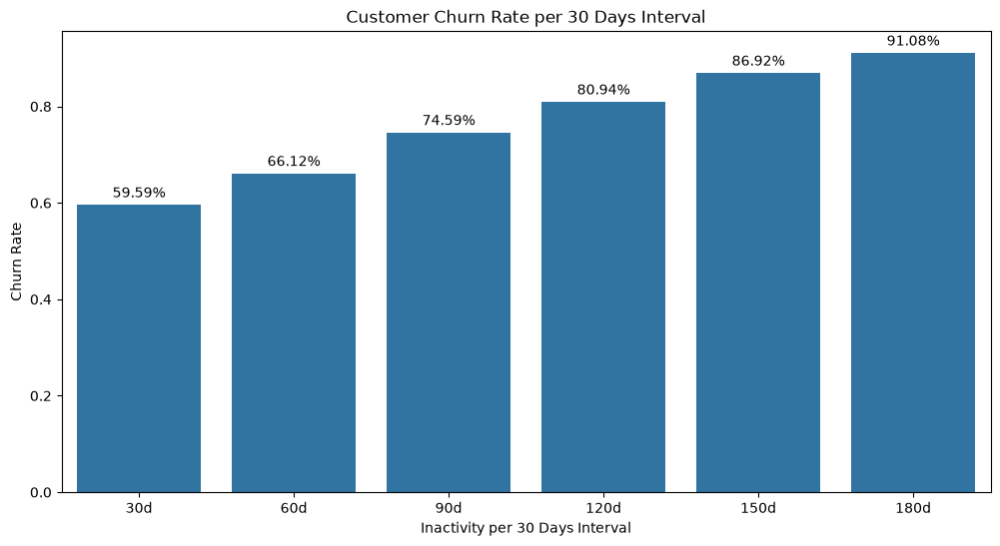
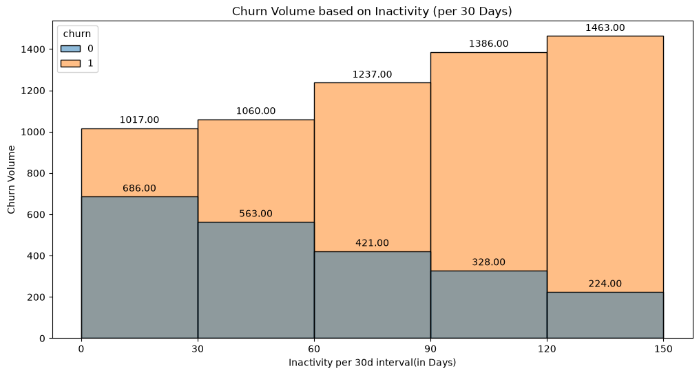
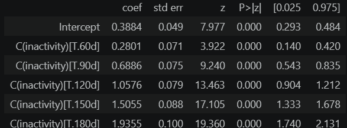
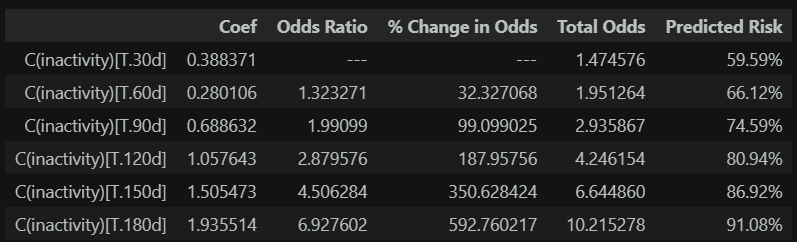

# Inactivity Churn Analysis : A Logistic Regression Analysis for Identifying Inactivity Churn Tendency

## Deliverables
- Target Variable Analysis
- Hypothesis testing
- Logistic Regression Analysis
- Executive Summary

## Question
    How quickly does inactivity turn into churn?
    Is there a threshold where risks jumps?

## Results
| | |
--|--
**_Initial Findings_** Longer customer inactivity have a higher chance of churning and each 30 days interval increases the total churned by approx. 200 customers|
**_Hypothesis Results_** Customer inactivity shows a positive relationship with churn rate and is strongly significant for all intervals and.  Inverse Transformation Results shows that a 90 days inactivity is the ideal threshold for escalating customer re-engagement.  All of the results rejects the null hypothesis, therefore, we can conclude that customer inactivity has a positive effect on the log-odds of customer churn|